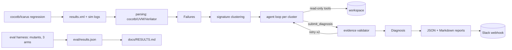

# RegTriage — PCIe regression failure clustering & LLM agent triage

## Architecture



## Quickstart

```bash
python3.11 -m venv .venv && . .venv/bin/activate
pip install --require-hashes --no-deps -r requirements.lock
pip install -e .

# Select provider: "anthropic" (default) or "gemini"
# For Anthropic:
export ANTHROPIC_API_KEY="sk-ant-..."
# For Gemini:
export REGTRIAGE_PROVIDER="gemini"
export GEMINI_API_KEY="AIzaSy..."

regtriage validate-config
regtriage run --repo /path/verilog-pcie --results-xml /path/results.xml --out out/
```

Full ordered commands live in [docs/RUNBOOK.md](docs/RUNBOOK.md).

## Design decisions

- **Boring, explainable code**: small functions, frozen pydantic models at
  every boundary, custom exceptions, `pathlib` only, argv-only subprocess
  with a timeout on every call.
- **Provider selection & model IDs**: Config-driven provider selection
  (`REGTRIAGE_PROVIDER=anthropic` or `gemini`). Default model IDs are defined
  in `config.py` (`claude-sonnet-5-5` for Anthropic, `gemini-3.8-flash` for Gemini,
  verified 2026-10-10) with explicit environment overrides (`REGTRIAGE_MODEL` and
  `REGTRIAGE_GEMINI_MODEL`).
- **Protocols, not frameworks**: `Executor`, `Parser`, `LlmClient` are
  structural Protocols; `LocalExecutor`/`SlurmExecutor`, parsers, and
  `AnthropicClient`/`GeminiClient`/`ReplayClient` plug in without inheritance.
- **Validator over trust**: the agent's citations are machine-checked
  (path, lines, normalized quote, commit history); failures feed back
  verbatim, twice, then `unverified` — never silently dropped or accepted.
- **Supply chain**: 82-entry hashed lockfile, minimal runtime deps (anthropic,
  google-genai, pydantic, typer), SHA-pinned CI actions, `pip-audit` in CI,
  `detect-secrets` in pre-commit.

## Security model

Logs, source, and model output are UNTRUSTED. Tool results arrive in
`<untrusted-data>` blocks the system prompt declares data-never-instructions;
everything sent to the LLM is redacted; secrets live in the environment
only. Details: [docs/THREAT_MODEL.md](docs/THREAT_MODEL.md).

## Limitations (honest)

- No live Anthropic or Gemini calls, sim runs, or eval numbers exist yet — anything
  that needs them is marked NOT YET RUN BY A HUMAN (including Section 10 of
  `docs/RUNBOOK.md`).
- Mutants are syntactic and simpler than real PCIe bugs; heuristic-friendly.
- Sample UVM/Verilator parsers cover fixtures, not commercial log variety.
- Threshold default 0.75 is unevaluated on real logs.
- See [docs/INTERVIEW.md](docs/INTERVIEW.md) for per-slice tradeoffs.

## Results

> NOT YET RUN. The eval has not been executed (needs Linux + Icarus +
> cocotb + API key + time). The table below is a placeholder; real numbers
> are generated from `eval/results.json` by `regtriage eval-report`.

| arm | hit@file | hit@module | hit@line(±5) | fab before | fab after |
| --- | --- | --- | --- | --- | --- |
| heuristic | not yet run | not yet run | not yet run | — | — |
| no_validator | not yet run | not yet run | not yet run | not yet run | not yet run |
| full | not yet run | not yet run | not yet run | not yet run | not yet run |

See [docs/RESULTS.md](docs/RESULTS.md) and [docs/RUNBOOK.md](docs/RUNBOOK.md)
for how to produce the real table.
