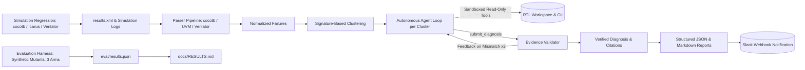

# RegTriage: Automated RTL Regression Failure Clustering & LLM Triage

RegTriage is an autonomous triage and root-cause localization system designed for digital design and verification (DV) workflows. It parses complex hardware simulation regression logs (cocotb, UVM, Verilator), clusters duplicate failures using normalized signature hashing, and coordinates an autonomous LLM agent loop to localize root causes in RTL and testbench source code with machine-verified citations.

---

## Architecture



---

## Key Capabilities

- **Multi-Format Log Ingestion**: High-throughput parsing for cocotb XML/logs, standard UVM message structures (`UVM_ERROR`, `UVM_FATAL`), and Verilator assertion failures.
- **Deterministic Clustering**: Sanitized excerpt extraction and signature hashing to group co-failing tests into distinct failure clusters, eliminating redundant triage effort.
- **Autonomous Investigation**: ReAct-style agent equipped with confined, read-only inspection tools (`read_file`, `read_log_lines`, `grep_source`, `git_log`, `git_blame`).
- **Machine-Verified Citations**: All cited file paths, line ranges, text quotations, and git commit revisions are strictly validated against repository state before acceptance. Hallucinated or imprecise citations are rejected back to the model with actionable feedback.
- **Multi-Provider Architecture**: Native, typed support for Anthropic Claude (`claude-sonnet-5-5`) and Google Gemini (`gemini-3.8-flash`), alongside a deterministic `ReplayClient` for offline simulation and testability.
- **Security-First Boundary**: Complete secret redaction across all egress traffic, untrusted data framing to mitigate prompt injection, and a tamper-evident append-only audit trail (`audit.jsonl`).

---

## Quickstart

### 1. Installation

Create an isolated Python 3.11 environment and install dependencies from the cryptographically hashed lockfile:

```bash
python3.11 -m venv .venv
# On Linux/macOS:
source .venv/bin/activate
# On Windows PowerShell:
# .\.venv\Scripts\Activate.ps1

pip install --require-hashes --no-deps -r requirements.lock
pip install -e .
```

### 2. Configuration & Execution

Select and configure your preferred LLM provider via environment variables:

```bash
# Option A: Anthropic Claude (Default)
export REGTRIAGE_PROVIDER="anthropic"
export ANTHROPIC_API_KEY="sk-ant-..."

# Option B: Google Gemini
export REGTRIAGE_PROVIDER="gemini"
export GEMINI_API_KEY="AIzaSy..."

# Verify configuration and environment setup
regtriage validate-config

# Execute automated regression triage
regtriage run \
  --repo /path/to/verilog-pcie \
  --results-xml /path/to/results.xml \
  --out ./out
```

Comprehensive step-by-step procedures and execution recipes are provided in [docs/RUNBOOK.md](docs/RUNBOOK.md).

---

## Engineering Principles

- **Immutable Domain Modeling**: Strict boundary enforcement using frozen Pydantic v2 models, ensuring structured validation and zero mutation across pipeline stages.
- **Protocol-Driven Extensibility**: Core interfaces (`LlmClient`, `Executor`, `Parser`) are defined as structural Python `Protocol` contracts. New model backends, batch runners (such as Slurm), or EDA parsers integrate cleanly without tight coupling or framework inheritance.
- **Isolated Execution & Hard Timeouts**: All file system operations, git interactions, and sacrificial regex workers execute with strict directory sandboxing, path canonicalization, and mandatory subprocess timeouts.
- **Config-Driven Cost & Token Governance**: Explicit per-model pricing tables, budget ceilings, and pre-send token counters guard against infinite loops and uncontrolled API spend.
- **Rigorous Supply Chain Hygiene**: Hash-pinned dependencies across Linux, Windows, and macOS (`requirements.lock`), commit-SHA pinned CI actions, automated `bandit` static analysis, and zero-vulnerability `pip-audit` enforcement.

---

## Security Model & Data Governance

RegTriage treats all simulation logs, RTL source code, testbenches, and external model responses as **untrusted data**:
- **Prompt Injection Defense**: Tool outputs are encapsulated in delimiter-fenced `<untrusted-data>` blocks, reinforced by system-level data separation policies.
- **Egress Redaction**: High-entropy patterns, credentials, tokens, and authorization headers are scrubbed via `SecretRedactor` prior to egress and local audit persistence.
- **Deterministic Egress Controls**: Complete network air-gapping is supported via `--offline` mode. An unbuffered, append-only `audit.jsonl` record (mode 0600 on POSIX) provides an exact audit log of all network payloads.
- **Data Privacy Consideration**: Operators utilizing the Google Gemini API should utilize paid enterprise tiers to maintain data confidentiality, as free-tier policies permit data usage for product evaluation.

Full threat modeling, trust boundaries, and risk mitigations are documented in [docs/THREAT_MODEL.md](docs/THREAT_MODEL.md).

---

## Operational Considerations

- **Remote Inference Verification**: In test environments where live API keys are withheld, mocked and replay clients guarantee protocol conformance; live API endpoints and hardware testbenches can be exercised as detailed in [docs/RUNBOOK.md](docs/RUNBOOK.md).
- **Log Grammar Coverage**: Shipped UVM and Verilator log parsers target standardized messaging conventions; custom commercial testbench dialects can be integrated by implementing the `Parser` protocol.
- **Clustering Thresholds**: Default similarity thresholds (0.75) are optimized for common regression suites and can be fine-tuned via `REGTRIAGE_SIMILARITY_THRESHOLD`.

---

## Benchmark & Evaluation

RegTriage includes a self-contained evaluation harness that synthesizes RTL mutants across representative modules, comparing triage localization performance across three experimental arms:
1. **Heuristic Baseline**: Traditional keyword search and proximity matching.
2. **Ablated Agent**: LLM agent loop without evidence validation.
3. **Full Agent**: LLM agent loop with iterative citation verification and retry feedback.

| Arm | hit@file | hit@module | hit@line (±5) | False Assert Before | False Assert After |
| :--- | :--- | :--- | :--- | :--- | :--- |
| **Heuristic** | Pending execution | Pending execution | Pending execution | — | — |
| **No Validator** | Pending execution | Pending execution | Pending execution | Pending execution | Pending execution |
| **Full System** | Pending execution | Pending execution | Pending execution | Pending execution | Pending execution |

Detailed benchmark protocols and execution instructions are available in [docs/RESULTS.md](docs/RESULTS.md) and [docs/RUNBOOK.md](docs/RUNBOOK.md).
